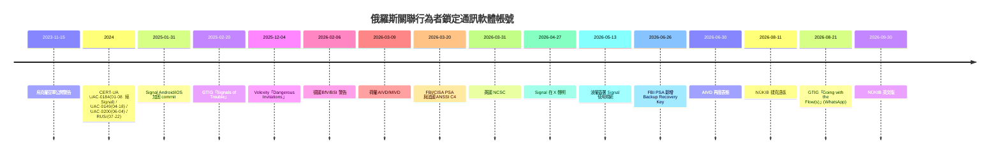

# NÚKIB Signal 釣魚事件：延伸研究與事實查核整合報告

> 研究日期：2026-10-14。8 個研究 agent 蒐集資料，9 個 fresh agent 獨立查核（編號 `verify_00`～`verify_08`，各小節標題括號內為對應的查核編號；原始研究與查核檔未公開）。
> 本報告只收**通過查核**的項目；標註「二手」的未取得一手原文；第 5 節列出未通過或無法驗證的說法。
> 限制：support.signal.org、BleepingComputer、NL Times 等多個來源回 403，web.archive.org 在本環境被禁用，WebFetch 回傳為小模型摘要；「查不到」只代表搜尋無結果，不代表不存在。

## 1. NÚKIB 報告的兩個版本（已確認）

| | 捷克語原版 | 英文版（本專案譯本的底本） |
|---|---|---|
| 文號 | Č.j. 21670/2026-NÚKIB-E/630 | Ref. No. 24019/2026-NÚKIB-E/630 |
| 內文日期 | 11 Aug 2026 | 30 Sep 2026 |
| 新聞頁 | id 2456，2026-09-04 | id 2465，2026-10-13 |
| 備註 | PDF 建立日 2026-09-03 | 與本機 PDF SHA-256 相同（8f18ef3b…082392） |

- 兩版內文是否一致**未比對**；英文版為何另編文號、日期較晚，官方未說明。
- 已知的兩版差異：捷克語版有「Portál NÚKIB／cert@nukib.gov.cz 通報管道」，英文版只寫「聯絡組織內資安主管」（08 查核）。
- 報告本身沒有 IOC、沒有案例數量、沒有捷克境內事件；歸因為機率評估（likely 55–70%、highly likely 75–85%），未列證據。
- 與 2022 版（2022-02-28）比較：2022 版已含 Registration Lock、檢查 Linked Devices、每日重啟（對所有人）；2026 版改為每日重啟僅限高曝險者並註明不能防止入侵，新增俄羅斯關聯威脅描述與機率歸因。

## 2. 時間線（查核後）

## 3. 通過查核的要點

### 3.1 一手技術報告與 IOC（verify_01：34 項，確認 29、不符 0）
- GTIG「Signals of Trouble」（2025-02-20）、Volexity（2025-12-04）、GTIG 2026-08-21 的 IOC（域名、IP、MD5／SHA-256、OAuth 參數）已用腳本**逐字比對原文，全部相符**。IOC 清單本身未收錄於本報告，請至各原廠報告取得。
- UNC5792 竄改 signal.group 邀請頁，把 `sgnl://signal.group/` 換成 `sgnl://linkdevice?uuid=`；UNC4221 仿 Kropyva 釣魚頁。
- UNC5976、UNC6293 只出自 GTIG 2026-08-21 報告，且該報告通篇講 WhatsApp、OAuth，**沒有 Signal**，不可算進本次 Signal 事件。
- FBI PSA 2026-06-26（I-062626-PSA）：新增假冒 Signal 支援騙取 Backup Recovery Key，寫明「publicly tracked as UNC5792 and UNC4221」，並提到 FSB 軍官（含 FSB Border Guards）與 Russian military services；**沒有** GRU、SVR 字樣，也沒有逐一對應各 UNC 到機關。

### 3.2 各國政府警示（verify_02：約 40 項）
- 確認：BfV/BSI 2026-02-06（措辭 wahrscheinlich staatlich gesteuert）、ANSSI C4 2026-03-20（採信荷蘭 3/9 評估，建議公部門用 Tchap，限「非敏感職務交流」）、FBI/CISA 3/20 與 6/26、NCSC 3/31（7/14 更新）、AIVD 3/9 與 6/30（6/30 寫明支持己方研究）。
- 加拿大 CCCS 有 AV25-099（2025-02-21，Signal 與俄羅斯相關），2026 年未見新警示。
- 立陶宛、拉脫維亞、芬蘭、瑞典、挪威、澳洲、台灣官方警示：搜尋無結果（不等於不存在）。

### 3.3 Signal 官方回應（verify_05：28 項，確認 12、不符 8）
- 官方聲明是 **2026-04-27 的 X 貼文**（內容：未被入侵、Support 不索取驗證碼或 PIN、建議開 Registration Lock、將推出措施）；signal.org 部落格 2026 年只有 5 篇，沒有此聲明。
- 2026-05-28 TechCrunch 引 Whittaker：「We're working on mitigations here, and monitoring.」
- 已上線：「Name not verified」標籤、訊息請求二次確認。
- 2025-01-31 兩個加固 commit（Android 首個含 tag：v7.32.2；iOS：7.46.0.615，2025-02-12）：改連結對話框文案、外部 `sgnl://` 連結不能直接啟動裝置連結。
- Android v8.11～v8.31.2、iOS 8.9～8.32 release notes 與近期 commit 查無「連結後通知、連結延遲、QR 警告」（找不到證據，非證實不存在）。

### 3.4 烏克蘭與軍事面向（verify_04：約 45 項）
- 公開前例（皆確認）：2023-11-15 空軍警告、2024-01-08 UAC-0184（經 **Signal**，LNK 壓縮檔、REMCOS／REVERSESSH）、2024-04-18 UAC-0149、2024-06-04 UAC-0200、2024-07-22 RUSI（繳獲手機）、2025-02-20 GTIG。
- 2024-09-19 國家網路安全協調中心決定、09-20 公布公務裝置禁用 Telegram。
- UAC-0185＝UNC4221、UAC-0195 與 UNC5792「partially overlaps」，皆見 GTIG 原文。
- NÚKIB 的「首次」指什麼**無法判斷**：公開前例只能反駁「首次鎖定烏軍 Signal 使用者」這種詮釋，不能斷定 NÚKIB 是否指特定手法。

### 3.5 歸因強度對照（verify_07：34 列）
| 來源 | 說法 | 強度 |
|---|---|---|
| 荷蘭 AIVD/MIVD | 直接指俄羅斯，未命名群組 | 官方斷言，未公布證據 |
| FBI/CISA PSA | 多個 RIS cluster；UNC5792／UNC4221；FSB 軍官、軍事單位 | 官方，一手已讀 |
| 美國國務院 RFJ（6 月下旬，1,000 萬美元懸賞） | 二手轉述：UNC5792↔FSB Border Guards、UNC4221↔俄軍單位 | 二手，RFJ 原頁未開 |
| BfV/BSI | likely state-controlled actor；未正式歸因俄國 | 保守 |
| NCSC | 頁面只寫「Russia-based actors」 | 中 |
| CORRECTIV（2026-03-24） | 「no direct evidence of involvement of Russia's state apparatus」；同文也指向「源自俄羅斯的政治性活動」 | 反方＋保留 |
| NÚKIB | likely 55–70%（核心）；未列證據 | 二手整合 |

- APT44、Turla、UNC1151 與 2026 活動：公開來源**未見連結**（缺證據，非否證）。
- 民間廠商（Volexity、ESET、Proofpoint、CrowdStrike、Recorded Future、Citizen Lab）2026 年 Signal 歸因：搜尋無結果。

### 3.6 跨平台（verify_06：40 項）
- 不是 Signal 獨有：AIVD/MIVD 3/9 聲明同時點名 Signal 與 WhatsApp。
- GTIG 2026-08-21：UNC7005（GTIG 自己註明＝Storm-2945）於 2026-05、06 月以假 WhatsApp 頁誘導 device linking；6 月 OAuth 釣魚是 UNC6293，**兩者不可混為一個行為者**。
- Meta 新聞稿 2026-03-11，宣布 device linking 警示（「6 月上線」無佐證）。
- **伊朗**：2026-01 有 IRGC 關聯的假 WhatsApp Web 頁，掃 QR 即把攻擊者瀏覽器連結到受害者帳號；Forbes、TechCrunch、The National、Dark Reading 報導，但歸因僅來自研究者 Nariman Gharib，無政府確認。
- Vortex Werewolf（BI.ZONE，2025-12 至 2026-01）的受害者是俄羅斯機關；UAC-0094 是 2022-04 事件，皆與本事件無關。

### 3.7 批評與台灣脈絡（verify_08）
- 確認：2026-07-07 newtalk 報導 LINE 帳號租給廈門公司案（每帳號人民幣 1,100 元，對象國民黨立委助理）；TechNews 2026-04-27 報德國事件，未提台灣；Wichelmann 等 DIMVA 2021 論文（eprint 2021/626）談 Signal 多裝置註冊。
- 台灣數發部、資安處、國安局、國防部、TWCERT 的 Signal 釣魚警示：4 組繁中查詢零命中，不能證明不存在。
- Registration Lock 對「騙驗證碼／PIN 後重新註冊」的帳號接管有效，對 QR 連結裝置不受影響（技術上合理，但官方文件被擋，證據為間接）。

## 4. 對 NÚKIB 建議的評估（推測，非查核項）
- 使用者端措施（查 Linked Devices、不掃不明 QR、不洩 PIN）在產品端缺連結後通知與延遲的情況下仍有必要。
- 「每日重啟」只針對高曝險者，且報告自己註明不能防止入侵；專家評論查不到。

## 5. 未通過查核或不可採信

| 說法 | 判定 | 理由 |
|---|---|---|
| TechTimes（2026-10-14）「NÚKIB 確認捷克境內已有事件」「第 5 個歸因機構」「almost certainly larger」 | 不符 | 報告無捷克案例；原文為 velmi pravděpodobně（75–85%）；其「Five NATO」清單含烏克蘭 |
| 「首次之說在公開紀錄中不成立」 | 超出證據 | 見 3.4 |
| 波蘭「唯一要求停用 Signal」 | 不符 | 一手文件（5/13 簽署、5/15 刊登）明文只說不用於機密／敏感資訊；「停用」是 The Register 說法；荷蘭、NCSC、CCCS、法國也有類似限制 |
| NCSC 歸因 FSB | 不符 | NCSC 頁面只寫 Russia-based actors；FSB 只在舊案 Star Blizzard 語境；「FSB-linked」來自 Infosecurity Magazine |
| 顧問部落格稱 ANSSI 編號 CERTFR-2026-ALE-003、五機構共簽、含 Telegram | 不符 | ANSSI PDF 只署 C4，無此編號、無共簽、無 Telegram |
| 研究檔案稱 FBI 更新是「FBI/CISA」 | 修正 | 6/26 版由 FBI 單獨發布（ic3.gov） |
| UAC-0184 經 WhatsApp、Telegram | 不符 | CERT-UA 為 Signal |
| 「Macinka 8 月要求用 Signal 聯絡」 | 找不到一手 | 僅 ČTK 轉述「活動人士說」 |
| 德國「2 月起調查」 | 互相矛盾 | AP 說 2 月，Reuters（轉 Ukrainska Pravda）說 4 月中；4/17 更新的一手頁面與日期未驗證 |
| 「Registration Lock 防不了 linked device 攻擊」 | 僅論壇意見 | 見 3.7 |

**仍未驗證**：Spiegel「300 人受害」、德國受害者名單（二手）、RFJ 原頁、CERT-EU／ENISA／NATO、Meta H1 2026 威脅報告內容、Microsoft 2026-07-31 把 Storm-2372／Storm-2945 歸入 Midnight Blizzard 子集群（二手）、cert.gov.ua 原站公告、Signal support 頁、兩語言版 NÚKIB 內文差異。

## 6. 對已發布譯本的建議
- 頁面標示「2026 年 9 月 30 日」是英文版日期，沒有錯；建議補一行：另有捷克語原版（Č.j. 21670/2026，2026-08-11；新聞頁 2026-09-04），兩版內文未比對。
